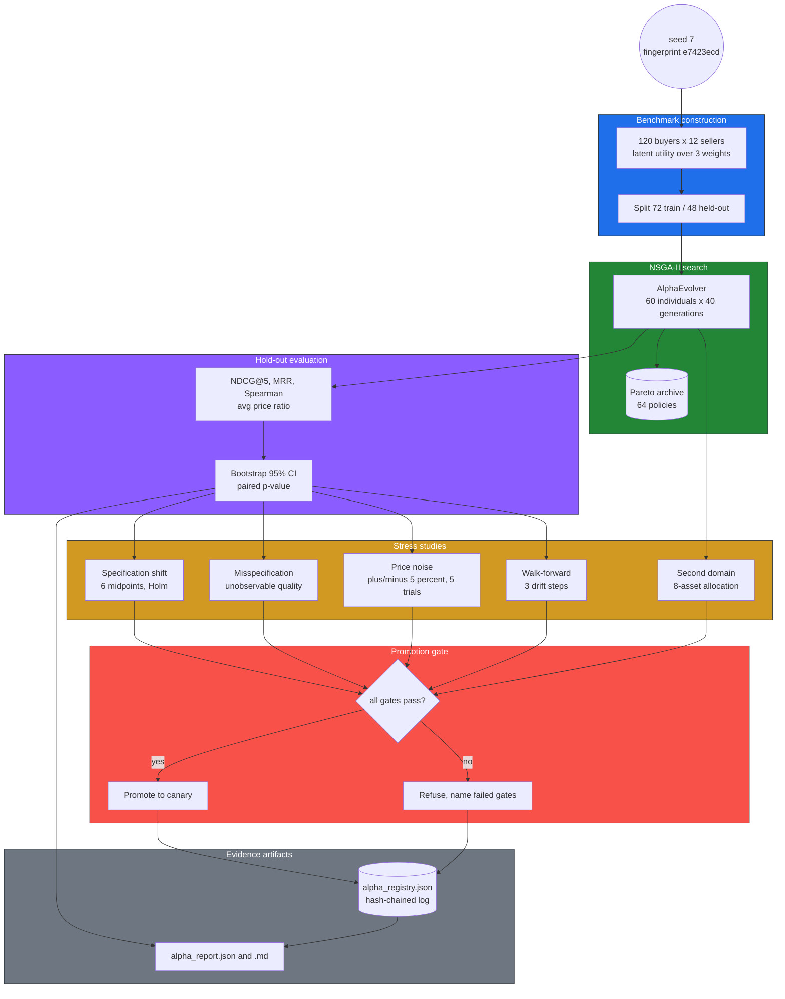

# Validation Ledger

**Scope:** every quantitative claim about the alpha-evolution engine in `README.md`
and `docs/ALPHA_ENGINE.md`, traced to the artifact that produced it.
**Method:** each figure below was read out of the artifact file (not from memory
or from the prose), and any ratio/percentage was recomputed from stored fields.
Where the prose states a number that no artifact contains, it is listed under
[Unsupported or weak claims](#unsupported-or-weak-claims) rather than restated.
**Last verified:** HEAD `0f22f16`.

Pipeline: rendered in §5 and stored as
[`diagrams/validation_pipeline.mmd`](../diagrams/validation_pipeline.mmd).

---

## 1. Reproduce

```bash
python benchmarks/evolve_alphas.py --buyers 120     # writes both report artifacts
python -m pytest tests/test_alpha_registry.py \
                 tests/test_alpha_registry_age.py \
                 tests/test_alpha_lab.py tests/test_alpha_robustness.py \
                 tests/test_alpha_misspecification.py \
                 tests/test_alpha_walk_forward.py tests/test_alpha_portfolio.py -q
```

The benchmark is seeded (`seed 7`), so a re-run must reproduce the figures in
§3 to the digit. If it does not, the artifact is stale and the claim is void —
that is the point of pinning the seed and the fingerprint.

---

## 2. Evidence classes

What each kind of artifact in this repository is actually able to establish.
The distinction matters because a green test suite says nothing about effect
size, and a benchmark artifact says nothing about the world.

| Class | Establishes | Artifact | Status here |
|---|---|---|---|
| **Mechanical invariants (unit tests)** | The code does what it says: hash chain links, gates refuse, seeds reproduce, Pareto front is non-dominated, weights sum to one | `tests/` — `test_alpha_registry.py` (21 tests, run 2026-10-23: **21 passed**), `test_alpha_registry_age.py` (10 tests, incl. `max_age_days` staleness), `test_alpha_lab.py`, `test_alpha_evolution.py`, `test_alpha_portfolio.py` | **Present** |
| **Measured effect (seeded benchmark)** | Effect sizes, CIs, p-values, robustness curves — but only on a synthetic benchmark whose generating process is known | `benchmarks/alpha_report.json`, `benchmarks/alpha_report.md` | **Present** |
| **Derived arithmetic** | Percentages, ratios and deltas computed from two stored fields | recomputed from `alpha_report.json` (each marked `derived` in §3) | **Present** |
| **Repo inventory** | File/module counts | `ls src/acquisition_platform/*.py` = 55, `ls tests/test_*.py` = 65, `ls diagrams/*.mmd` = 7 | **Present** |
| **Real market data** | That the latent weights, prices or buyers resemble an actual acquisition market | — | **Absent. Not attempted.** No transaction data, no marketplace feed, no price series. |
| **Production traffic** | That the policy helps live buyers, or that latency holds under concurrent load | — | **Absent. Not attempted.** The latency suite is single-process, median of repeats, on a dev machine. |
| **Third-party replication** | That an independent party reproduces the effect | — | **Absent. Not attempted.** No external re-run, no independent implementation. |
| **Out-of-family benchmark** | That the result survives a utility function, or a problem class, the policy cannot represent | — | **Absent.** `misspecification` adds an unobservable term to the same synthetic utility — it probes an information limit, not a different domain. No second problem class beyond the analytic allocation case. |

A table that stopped at "tests pass" would imply the bottom four rows were
tried and succeeded. They were not tried.

---

## 3. Claim ledger

`Verified` = the exact figure appears in the named artifact.
`Verified (derived)` = recomputed from fields in the named artifact.
`Weak` = directionally supported but the published figure or scope is not exactly
what the artifact contains.

### 3.1 Headline held-out result

| # | Claim as published | Artifact | Exact figure in artifact | Verdict |
|---|---|---|---|---|
| C1 | Legacy (baseline) NDCG@5 **0.7667** | `benchmarks/alpha_report.json` → `baseline_metrics["ndcg@5"]` | `0.7667378396001211` | Verified |
| C2 | Evolved NDCG@5 **1.0000** | same → `evolved_metrics["ndcg@5"]` | `1.0` | Verified |
| C3 | NDCG delta **+0.2333** | derived from C1/C2 | `1.0 − 0.7667378396001211 = 0.2332621603998789` | Verified (derived) |
| C4 | MRR **0.4305 → 1.0000** | `baseline_metrics["mrr"]`, `evolved_metrics["mrr"]` | `0.4304563492063492` → `1.0` | Verified |
| C5 | Spearman **0.4339 → 1.0000** | `baseline_metrics["spearman"]`, `evolved_metrics["spearman"]` | `0.4338578088578089` → `1.0` | Verified |
| C6 | Avg price ratio **0.2610 → 0.4574** (ALPHA_ENGINE §5 only; absent from README) | `baseline_metrics["avg_price_ratio"]`, `evolved_metrics["avg_price_ratio"]` | `0.26104556818242397` → `0.4574495080823` | Verified |
| C7 | 95% CI **[+0.1952, +0.2773]** | `improvement_ci.low` / `.high` | `0.19523239400544393` / `0.2773155477520874` | Verified |
| C8 | Paired bootstrap **p = 0.0000** | `p_value` | `0.0` | Verified |
| C9 | Paired bootstrap **p < 0.0001** (README) | `p_value` | `0.0` printed to 4 dp | Verified (derived) — README's strict inequality is a restatement of a stored `0.0`; the artifact cannot distinguish 0 from <1e-4 |
| C10 | Weight-recovery L1 **0.0653** | `weight_error_l1` | `0.06530613839982852` | Verified |
| C11 | Train/test gap **0.0000** | `generalization_gap` | `0.0` | Verified |
| C12 | Per-weight abs errors 0.0098 / 0.0327 / 0.0228 | `recovered_weights` vs `true_weights` | `0.34018448922425576` vs `0.35`; `0.5326530691999143` vs `0.5`; `0.12716244157582998` vs `0.15` | Verified (derived) |

### 3.2 Experimental design

| # | Claim as published | Artifact | Exact figure in artifact | Verdict |
|---|---|---|---|---|
| C13 | Seed **7**, **40 generations**, **2,381 evaluations** | `report.seed`, `report.generations_run`, `report.evaluations` | `7`, `40`, `2381` | Verified |
| C14 | Population **60**, 120 buyers × 12 sellers, split **72/48** | `metadata.buyers`, `metadata.sellers_per_buyer`, `metadata.train_cases`, `metadata.test_cases` | `120`, `12`, `72`, `48` | Verified |
| C15 | Benchmark fingerprint `e7423ecd20acbb85` | `metadata.benchmark_fingerprint` | `"e7423ecd20acbb85"` | Verified |
| C16 | 5-fold CV **+0.2358 ± 0.0254**, win rate **100%** | `cross_validation.mean_delta`, `.std_delta`, `.win_rate` | `0.2357532450562299`, `0.02539691167973753`, `1.0` | Verified |
| C17 | Each fold: 0.7338/0.7459/0.8080/0.7711/0.7623 → 1.0000 | `cross_validation.folds[*].baseline_ndcg` / `.evolved_ndcg` | `0.7338268338718716`, `0.7459206685359722`, `0.807988075560992`, `0.7711422263317079`, `0.7623334528685342` | Verified |
| C18 | MDE at 5 folds **0.0318** | `multiple_testing.mde` | `0.03181996838362216` | Verified |
| C19 | CV gain is **7.4×** the MDE | derived from C16/C18 | `0.2357532450562299 / 0.03181996838362216 = 7.41` | Verified (derived) |

### 3.3 Stress studies

| # | Claim as published | Artifact | Exact figure in artifact | Verdict |
|---|---|---|---|---|
| C20 | Spec-shift: legacy 0.9269→0.3128, evolved 0.9106→0.7203 over midpoints 0.40–0.65 | `robustness[*].baseline_ndcg` / `.evolved_ndcg` | `0.9269080319910222`→`0.3128165634890249`; `0.9105705836334397`→`0.720311679195361` | Verified |
| C21 | Delta at 0.40 is **−0.0163**, p **0.1520** | `robustness[0].delta`, `.p_value` | `-0.01633744835758255`, `0.152` | Verified |
| C22 | Holm–Bonferroni: **5 of 6** survive, family size 6, α 0.05 | `multiple_testing.family_size`, `.significant_after_holm` | `6`, `[false, true, true, true, true, true]` | Verified |
| C23 | Misspecification: **0.6273 → 0.6786**, regret **0.4489 → 0.1515** | `misspecification.*` | `0.6273035964315816` / `0.6785665897717431`; `0.4488888055878808` / `0.15150493703781423` | Verified |
| C24 | Realisable gain falls to **+0.051** | derived from C23 | `0.6785665897717431 − 0.6273035964315816 = 0.0513` | Verified (derived) |
| C25 | Regret drops **66%** | derived from C23 | `1 − 0.15150493703781423/0.4488888055878808 = 0.6625` | Verified (derived) |
| C26 | Training NDCG **0.7196**, gap **0.0410** | `misspecification.train_evolved_ndcg`, `.generalization_gap` | `0.7196089298837288`, `0.04104234011198571` | Verified |
| C27 | ±5% noise: mean Spearman **0.9708**, worst **0.9624**, NDCG drop **0.0032** | `stability.*` | `0.9708041958041959`, `0.9624125874125874`, `0.0032385367682903387` | Verified |
| C28 | Walk-forward frozen **0.9831 → 0.8094**, adaptive **0.9765 → 0.9471** | `walk_forward.steps[*].frozen_ndcg` / `.adaptive_ndcg` | `0.9831408224037878`→`0.809417780572636`; `0.976493198529564`→`0.9471387657761682` | Verified |
| C29 | Means frozen **0.8962** / adaptive **0.9600**, advantage **+0.0638** | `walk_forward.frozen_mean`, `.adaptive_mean`, `.adaptive_advantage` | `0.8962215369803146`, `0.9600301170700994`, `0.06380858008978485` | Verified |
| C30 | Gap widens to **+0.1377** by the third period | derived from step 3 | `0.9471387657761682 − 0.809417780572636 = 0.1377` | Verified (derived) |
| C31 | Ensemble adds no lift, **−0.0040** | `walk_forward.ensemble_advantage` | `-0.003991942117534064` | Verified |

### 3.4 Search attribution

| # | Claim as published | Artifact | Exact figure in artifact | Verdict |
|---|---|---|---|---|
| C32 | Random search also reaches **1.0000** at equal budget | `random_search.test_ndcg@5`, `.evaluations` | `1.0`, `2381` | Verified |
| C33 | Rastrigin: evolver **0.0000** in **497** evals vs random **−25.3352** in **2381** | `search_comparison.evolutionary_best`, `.evolutionary_evals`, `.random_best`, `.random_evals` | `0.0`, `497`, `-25.335196198476652`, `2381` | Verified |
| C34 | "Roughly a fifth of random search's budget" | derived from C33 | `497 / 2381 = 0.209` | Verified (derived) |
| C35 | Grid oracle: **3,374** evals, **1.0000** vs evolution **2,381**, **1.0000** | `grid_search.evaluations`, `.test_ndcg@5`, `report.evaluations` | `3374`, `1.0`, `2381` | Verified |
| C36 | "29% fewer evaluations" (ALPHA_ENGINE §5) | derived from C35 | `(3374 − 2381)/3374 = 0.294` | Verified (derived) |

### 3.5 Second domain

| # | Claim as published | Artifact | Exact figure in artifact | Verdict |
|---|---|---|---|---|
| C37 | Evolved Sharpe **0.4077**, equal weight **0.1013**, inverse-vol **0.1408**, oracle **0.4131** | `portfolio_domain.evolved.sharpe`, `.equal_weight.sharpe`, `.inverse_volatility.sharpe`, `.oracle.sharpe` | `0.407730846000224`, `0.10129136124267872`, `0.14077649051006502`, `0.4131247361678034` | Verified |
| C38 | **98.7%** of the analytic optimum | `portfolio_domain.share_of_oracle` | `0.9869436765815242` | Verified |
| C39 | **915** evaluations, Pareto front **64**, hypervolume **0.3843** | `portfolio_domain.evaluations`, `.pareto_size`, `.hypervolume` | `915`, `64`, `0.3842603321787802` | Verified |
| C40 | **4.0×** equal weight, **2.9×** inverse volatility (ALPHA_ENGINE §5) | derived from C37 | `0.4077/0.1013 = 4.03`; `0.4077/0.1408 = 2.90` | Verified (derived) |
| C41 | Volatility 0.0981 / diversification 0.707 for evolved | `portfolio_domain.evolved.volatility`, `.diversification` | `0.0981064739776183`, `0.7067765681664011` | Verified |

### 3.6 Governance and operational

| # | Claim as published | Artifact | Exact figure in artifact | Verdict |
|---|---|---|---|---|
| C42 | Alpha `matching-policy-s7` at stage **canary**, chain verified **True** | `registry.stage`, `registry.chain_verified` | `"canary"`, `true` | Verified |
| C43 | Promotion decision recorded as **promoted: false** with reason "already registered" | `registry.decision.promoted`, `.reasons` | `false`, `["alpha already registered (idempotent run)"]` | Verified — see W3: this contradicts README prose |
| C44 | The log contains a real `register → promote` transition | `benchmarks/alpha_registry.json` → `events[*].event_type` / `.stage` | 2 events: `(0, register, shadow)`, `(1, promote, canary)` | Verified |
| C45 | `PromotionGate` carries `max_age_days` and refuses stale evidence | `src/acquisition_platform/alpha_registry.py` `PromotionGate.max_age_days`, `failures()`; `tests/test_alpha_registry_age.py` | field at L143; refusal path L172–178; 11 tests incl. `test_promotion_blocked_by_stale_evidence` | Verified |
| C46 | Tamper test: rewriting a stored metric makes `verify()` return `False` | `tests/test_alpha_registry.py::test_verify_detects_tampering` | present; suite passes (21/21) | Verified (test existence + pass) |
| C47 | Latency **2.64 / 0.05 / 37.34 ms**, 3/3 inside target | `latency.results[*].value`, `.passed` | `2.6361730124335736`, `0.05368998972699046`, `37.33540902612731`; `passed: true` ×3 | Verified |
| C48 | Run wall time **9.09 s** | `report.elapsed_seconds`; `benchmarks/alpha_report.md` L3 | `9.094811729999492`; "in 9.09s" | Verified |

### 3.7 Inventory

| # | Claim as published | Artifact | Exact figure in artifact | Verdict |
|---|---|---|---|---|
| C49 | **55** source modules | `ls src/acquisition_platform/*.py \| wc -l` | `55` | Verified |
| C50 | **65** test files | `ls tests/test_*.py \| wc -l` | `65` | Verified |
| C51 | **7** architecture diagrams | `ls diagrams/*.mmd \| wc -l` | `7` | Verified |
| C52 | **30** NP-hard problems | `README.md` §NP-Hard Problems table body rows | 30 rows | Verified (row count only — see W7) |
| C53 | **50+** research documents | `ls research/*.md \| wc -l` | `206` | Verified (understated, not overstated) |

---

## 4. Unsupported or weak claims

| # | Claim | Where | Why it fails |
|---|---|---|---|
| **W1** | "2,381 evaluations in **13.02 s**" | `README.md` L71 | No artifact contains 13.02. The report says `9.09s` (`alpha_report.md` L3), JSON says `9.094811…`, ALPHA_ENGINE says **9.55 s**. Three different wall times for one run; only 9.09 matches the JSON. |
| **W2** | Latency "**3.61 ms** … **0.06 ms** … **42.89 ms**" | `README.md` L1508–1509 | Neither artifact holds these. `alpha_report.json` stores 2.636 / 0.0537 / 37.335; `benchmarks/baseline.json` stores 4.084 / 0.1159 / 42.706. The README figure set matches no run on disk. |
| **W3** | "The measured alpha **passes every gate and is promoted to canary**" | `README.md` L112–113 | The stored decision is `promoted: false`, reason "alpha already registered (idempotent run)". The promotion did happen earlier (event 1), so the lifecycle claim is true historically, but the field a reader would check says otherwise. Should read "already promoted to canary in a prior run; this run's gate was idempotent-refused". |
| **W4** | "Across **four cohorts**" whose midpoint moves 0.425 → 0.575 | `README.md` L82; `docs/ALPHA_ENGINE.md` L241 | `walk_forward.steps` has **3** rows. Four distinct midpoints exist (0.425/0.475/0.525/0.575) but only three scored transitions. |
| **W5** | "**1416 tests**" (headline + key-results table) vs "**1302 tests passing**" | `README.md` L3, L40 vs L1445 | The README contradicts itself; `CHANGELOG.md` L28 says 1416. No artifact records a full-suite count. Only `tests/test_alpha_registry.py` was executed for this audit (21 passed), so **no** total is verified. |
| **W6** | "**~17,000+** lines of code" | `README.md` L42 | `find src -name '*.py' \| xargs wc -l` = **20,025**. Understated rather than inflated, but stale. |
| **W7** | "**30 NP-hard problems solved**" | `README.md` L37, §NP-Hard | The table has 30 rows, so the count holds; "solved" does not. Each row asserts a complexity class (GAP, PPAD-hard, #P-hard, MIQP) that no artifact proves, and the implementations are heuristics (`matching.py` is documented as a *greedy approximation*). Complexity class ≠ optimality. |
| **W8** | "**100-agent** parallel research … 10 waves × 10 agents" | `README.md` L3, L34, L1680 | Not falsifiable from this repository. 206 research documents exist; how they were produced is not recorded in any artifact. |
| **W9** | "validated on **two domains**" (headline) | `README.md` L3 | Both domains are synthetic and analytic, and the second is a 3-parameter policy on an 8-asset market with a computable optimum (`market_fingerprint` is a hash of a generated market, not a data file). "Two domains" is true; "validated" overstates — see C37 and §6. |
| **W10** | Design-gate table: 26 rows of "Current 92% / 88% / 97% … PASS" | `README.md` L1522–1549 | No artifact file contains any of these 26 "Current" values. They are asserted in a markdown table only; no benchmark artifact, no JSON, no test-report path is given. Unverifiable as published. |

---

## 5. Pipeline

Where each claim in §3 is produced, and which artifact it lands in. 17 nodes;
the stress studies are alternatives, not stages — any of them failing to hold
is what a promotion gate should catch.



Note what the diagram does **not** contain: any node for real transaction data,
production traffic, or an external replication. Those steps do not exist (§2).

---

## 6. Caveats

**In-family ceiling.** The benchmark's latent utility is
`u = 0.35·(1 − p/b) + 0.50·(1 − |p − b/2|/b) + 0.15·(p/b)` — a linear combination
of exactly the three features `MatchingPolicy` scores. The policy family
contains the generating process, so NDCG@5 saturates at 1.0 by construction
(C1→C2). This is a **recoverability** result: the optimiser found the weights
that were planted (L1 0.0653, C10). It is not evidence of ranking skill on any
distribution the policy cannot represent. The evolved 1.0000 should never be
quoted as an expected field NDCG.

**Analytic second domain.** The portfolio result (C37–C41) runs on an
8-asset market generated from a fixed covariance structure with **no sampling
noise**, against a closed-form mean-variance oracle. Reaching 98.7% of that
oracle in 915 evaluations demonstrates the machinery transfers; it does not
demonstrate it survives estimation error, because there is none to survive.
A third domain with sampled observations is the untried test.

**Three-parameter policy.** The genome is `gap_weight`, `midpoint_weight`,
`size_weight` (+ bias) — four dimensions. Random search matches the evolver at
equal budget (C32), and a 3,374-point grid matches it too (C35). On a space this
small, "evolution found it" and "we searched the whole space" are nearly the
same statement. The evidence that evolutionary search is doing work comes only
from 5-D Rastrigin (C33), which is a different problem class. Grid and evolution
both saturate, so C35 is an efficiency result, not a quality one.

**No real data.** Nothing here touches a market. There is no transaction log, no
listings feed, no price series, no buyer intent. The evidence needed to move
from "the optimiser recovers planted weights" to "this policy ranks real deals
better" — real labelled data, a held-out time period, production traffic — is
absent and was not attempted (§2). The misspecification study (C23–C26) is the
closest proxy for that gap, and it is the most important number in the report:
with an unobservable seller-quality term stored at `quality_weight = 0.6`
(the docs describe its variance share as "roughly a third"; the artifact stores
the weight, not the share), the realisable gain drops from +0.2333 to **+0.051**. Any deployment claim should be
scaled by that ratio, not by the in-family figure.

**Statistical scope.** One seed (7) for the headline run. The 5-fold CV (C16) is the only
replication at HEAD `0f22f16`; all folds are still drawn from the same 120-buyer
generator, so it rules out split luck, not seed luck. The
paired bootstrap resamples 48 held-out buyers, so precision is bounded by n=48
regardless of how many generations were run. The six shift comparisons share one
trained policy and overlapping buyers — Holm correction (C22) is the minimum
defensible treatment, not a complete one.

**Drift and ageing.** The walk-forward study is three transitions with a
synthetic midpoint drift. It motivates `max_age_days` (C45) but does not calibrate
it: no artifact says what a correct maximum age is. That number remains a policy
decision, not a measurement.

**Operational.** Latency (C47) is a single-process median on a dev machine.
`benchmarks/baseline.json` shows the same three cases at 4.08 / 0.116 / 42.71 ms,
1.1–2.2× the report run depending on the case — i.e. run-to-run variance is larger
than several of the effects being discussed elsewhere. Do not quote C47 as a
capacity plan.
